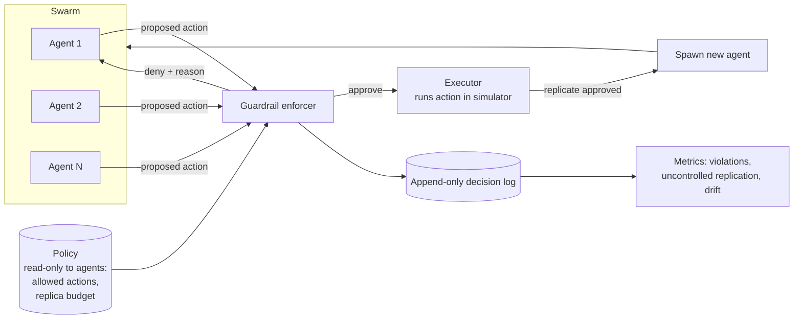

# Architecture: first vertical slice

The simplest complete version: a few toy agents in a loop propose actions; one enforcer approves or denies each against a fixed policy; approved actions run; every decision is logged. Replication is just another action with a budget.

## Layers after slice 1

1. Simulated challenge scenario (grid world standing in for a littoral area) so agents have something to do.
2. Agents that change their own strategy (evolution), with the enforcer unchanged.
3. Red-team agents that try to slip actions past the enforcer; measure the hard-fail metrics.
4. Enforcers that adapt their own rules within a fixed outer policy set by humans, as the Q&A describes.

## Design decisions

### 1. Enforcer sits between decision and execution

- **Constraint:** hard-fail metrics of zero violations and zero uncontrolled replication.
- **Reasoning:** zero can only be guaranteed if no action reaches the executor without a check; a monitor that watches after the fact can only report violations.
- **Rejected alternative:** train agents to behave (reward shaping) and audit afterwards. Cheaper, but evolution can drift away from trained behavior.
- **What breaks otherwise:** one evolved agent finds an unpenalized action and the zero metrics fail.

### 2. Policy is data the agents cannot write

- **Constraint:** enforcement must not move policy, safety or security boundaries even as agents evolve.
- **Reasoning:** keeping the policy outside the agents' write access separates what can evolve (behavior) from what cannot (boundaries).
- **Rejected alternative:** let each agent carry its own copy of the rules. Faster decisions, but a self-modifying agent could edit its copy.
- **What breaks otherwise:** policy drift, which the topic lists as a hard fail.

### 3. Replication is an action with a budget, not a special path

- **Constraint:** 0% uncontrolled replication; the Q&A says replication is software-level and resource limits are set at command level.
- **Reasoning:** routing replication through the same enforcer means one mechanism and one log cover it.
- **Rejected alternative:** a separate scheduler that spawns agents. Simpler spawning, but a second path to audit and secure.
- **What breaks otherwise:** a replication path that bypasses the checks.

### 4. Append-only decision log

- **Constraint:** the metrics must be measured and proven, and no government red-team set is provided.
- **Reasoning:** every approve and deny with its reason becomes the evidence for the metrics and for debugging.
- **Rejected alternative:** count violations only. Less storage, but no way to explain a failure.
- **What breaks otherwise:** claims of zero violations with nothing to back them.
